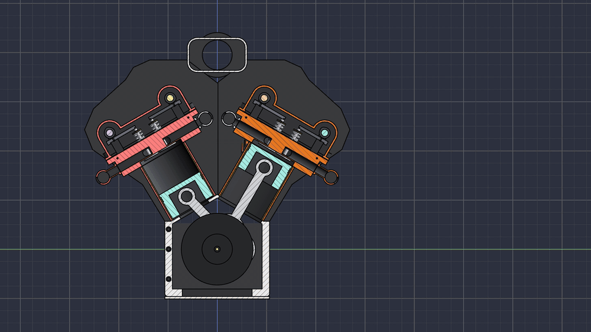

# Mechanical design portfolio

Karan Dutt Neelakantrao, MSc Intelligent Manufacturing at TU Clausthal and
B.Tech Mechanical Engineering from ANITS (First Class with Distinction).

Designing mechanical systems in CAD has run through my bachelor's, several
design and CAD/CAM internships, and a long stretch as the go-to mechanical
person for friends and teammates building electronics-heavy competition
projects, where the brief was usually structure, packaging, and airframes
around hardware someone else had already chosen. A laptop hardware failure
took out most of my working files, so this repo holds the three projects I
cared enough about to rebuild properly from surviving references, aiming to
show how I model and structure an assembly instead of leaving the work as
screenshots.



## Projects

| Project | What it is | Files |
|---|---|---|
| [Competition quadcopter airframe](drone/) | 8 kg class, 15" props, Quad-X, dual 6S, airframe designed around a teammate's electronics stack | [STEP](drone/cad/Racing_Drone_Verified.step) |
| [1/8 scale RC race car](rc-car/) | Chassis, drivetrain, and suspension for a friend's Technoxian competition team | [STEP](rc-car/cad/RC_Race_Car_Engineering_RevA_CleanTree.step) |
| [Toyota 2GR-FE V6 engine](v6-engine/) | 60° V6 with split-pin crankshaft and full DOHC valvetrain, built from published production dimensions | [STEP](v6-engine/cad/Toyota_2GR_FE_V6_Assembly.step), [GIF](v6-engine/media/Toyota_2GR_FE_V6_Section_Motion.gif) |

Internship work and other competition designs are not in this repo. Some are
covered by NDA and others were lost with the same hardware failure, so they
will be added as they are reconstructed.

## Software

Fusion 360 is the primary tool, alongside SolidWorks, Siemens NX, and CATIA,
with script-based parametric modelling in build123d and CadQuery.

## Repo layout

```text
drone/        competition quadcopter airframe
rc-car/       1/8 scale RC race car
v6-engine/    Toyota 2GR-FE V6 assembly and section animation
```

Each project folder has its own README with specifications, the assembly
breakdown, and a note on what was recovered versus reconstructed.

## Note on the files

Each project was rebuilt from surviving STEP references, screenshots, and team
files where the work was collaborative. Files here are STEP outputs, and the
parametric build scripts stay private.

## Licence

MIT, see [LICENCE](LICENCE).

## Contact

- LinkedIn: [karan-dutt-neelakantrao](https://linkedin.com/in/karan-dutt-neelakantrao)
- GitHub: [Karanneel](https://github.com/Karanneel)
