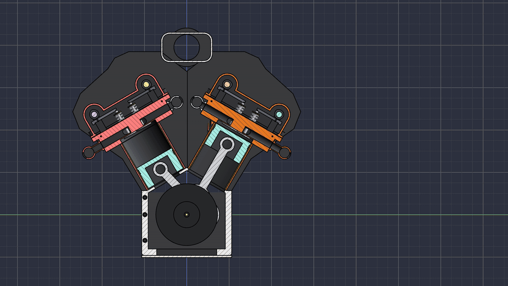

# Toyota 2GR-FE V6 engine

Assembly model of the Toyota 2GR-FE, a 3.5 L 60° DOHC V6, built from published production dimensions.



## Overview

Started as a bachelor's-era modelling exercise and rebuilt after a laptop failure, the assembly concentrates on the mechanism that makes a 60° V6 fire evenly, where the crankpins are split so that firing intervals land on 120° instead of the 60° and 180° pattern of a shared-pin layout. Around that crankshaft sit six pistons and rods, two heads with a complete valvetrain, four camshafts, and the timing drive, aiming to read as a working engine architecture instead of a block of loose solids.

## Section motion

The animation cuts through both banks and runs one full 720° cycle. Crank, rods and pistons follow slider-crank kinematics, cams turn at half crank speed, and each rocker is solved by roller contact on the cam lobe, which moves the valve and compresses its spring.

The STEP file holds static geometry, so the motion is computed from the geometry in the file instead of exported from a Fusion motion study. Joints exist only in the native Fusion model.

## Specification

| Parameter | Value |
|---|---|
| Displacement | 3,456 cc |
| Bore x stroke | 94.0 x 83.0 mm |
| Crank throw radius | 41.5 mm |
| Bank angle | 60° |
| Bore pitch (same bank) | 105.5 mm |
| Bank offset | 36.6 mm |
| Connecting rod length (centre to centre) | 147.5 mm |
| Crankpin split | 60° (120° minus bank angle) |
| Rod journal | Ø53 mm with modelled bearing shells |
| Firing order | 1-2-3-4-5-6, 120° intervals |
| Cylinder layout | Bank 1: 1-3-5, bank 2: 2-4-6 |
| Timing drive | 22T crank sprocket, 44T cam primary sprockets (2:1) |

## What is in the assembly

354 instances in a named assembly tree. The main groups are:

| Group | Contents |
|---|---|
| Block and crankcase | Two three-bore bank blocks, six separate liners, common lower crankcase with pan rail, pan cover, rear closure |
| Rotating assembly | One split-pin crankshaft, six pistons, six connecting rods with big-end caps |
| Cylinder heads | Bank 1 head and an opposite-hand bank 2 head, two cam covers, 0.5 mm head gasket envelopes |
| Valvetrain | 24 valves with retainers, split rings and springs, 24 hydraulic lash adjusters, 24 rocker rollers on roller rockers |
| Camshafts | Two intake and two exhaust shafts with six lobes each |
| Timing drive | Primary and secondary chains, sprockets, tensioners, damper, valley idler, enclosure |
| Intake and exhaust | Upper plenum, independent bank collectors, intake risers, two exhaust manifolds |

Fasteners are modelled as M5 and M6 envelopes, enough to show the layout without threads.

## Valve timing

Taken from the cam lobe phasing in the file and measured at 1 mm valve lift, with 6.0 mm maximum lift at the valve.

| Event | Angle |
|---|---|
| Intake opens | 58° after TDC |
| Intake closes | 16° after BDC |
| Exhaust opens | 6° before BDC |
| Exhaust closes | 50° before TDC |

The lobes are concept profiles with about 1.1 mm of lobe lift, amplified by the rockers, and the phasing leaves no valve overlap at TDC. A production 2GR-FE overlaps the valves through VVT-i, which is not modelled here.

## Files

```text
v6-engine/
  cad/Toyota_2GR_FE_V6_Assembly.step   full assembly, STEP AP214
  media/Toyota_2GR_FE_V6_Section_Motion.gif
```

## Reconstruction note

The original CAD was lost in a laptop hardware failure, so this version was rebuilt from Toyota's published 2GR-FE dimensions, cross-checked across service manual extracts and forum-verified stock rod dimensions. Deliberate simplifications keep the scope on assembly architecture and rotating-assembly kinematics, such as heads without ports, concept cam lobes without measured lift curves, no accessory drive, and no VVT-i actuators.
